# Spilltest 3: alle redskapene (05.11.2026)

Bestillingen: «La en playwright-agent prøve spillet. Den må prøve å fiske med alle redskapene i ulike scenarioer. Mål: Vurdere om alt fungerer eller om det finnes potensielle forbedringer. Vurdering av UX, UI, GUI. Forståelse av hvordan man bruker funksjonene i spillet.»

Agenten er `tests/fiskeplay.py`. Den spilte arbeidsgrenen `ccr-5e1ba2f4-pusvyd` (c5526524), bygd med hele kysten (`kart-31`). Bildene og det som ble sett, ligger i `tests/out/fiskeplay/` når skriptet er kjørt. Et utvalg bilder ligger i `docs/playtest/r3/`.

## Sammendrag

1. **Alle fire kystredskapene virker fra kjøp til levering**: juksa (hånd, juksamaskin og kveitepilk), line (hyseline og bankline), garn (torskegarn, flytegarn og blåkveitegarn) og teiner (kongekrabbe). Ingen sidefeil i 362 skjermbilder fra ni scenarioer: 238 liggende, 113 stående og 11 i 3D.
2. **Havredskapene kan spillerne ikke bruke ennå.** Trål, not, snurrevad, autoline og snøkrabbe er låst («kommer») i Båthandelen, som planen sier (`docs/planer/havsteget.md`, H2–H6). De er ikke prøvd.
3. **Sju feil som bør rettes** (F1–F7 under). Den alvorligste er at sluttseddelen kaller inndratt blåkveite for «Inndratt torsk over kvote» (F1). Rigg-fanen sender spilleren til feil sted for halere (F2), og butikken lover garn på startbåten, som ikke kan få garnhaler (F3).
4. **To klokker uten merking** er det største UX-problemet (U1). Klokka i HUD-en går i spilltid, men de fleste varighetene står i ekte tid uten at det står noe om det. «Kjøp og monter · 30 min» tar tre timer på klokka, og «Egn 16 … · 2 t 51 min» tar 17.
5. **Båten driver fra redskapet** mens det står (U2): 6–25 km på 12–24 timer, en gang inn på 1 m dyp. Det kommer ingen varsel, og «Kast anker» er grå over 40 m. Etterpå sier «Ta opp» «Nærmeste blåse er 13,8 nm unna».
6. **Varslene drukner** (U4): 74 trofémeldinger og 51 fartstidsmeldinger i løpet av testen, ofte oppå kortet spilleren bruker.
7. **Tre ting å avgjøre om balansen** (K1–K3): Lofoten i skreisesongen er tynn (kjent, backloggen 10.5), lina fisker langt under kalibreringen i `docs/systemer/redskap.md`, og teinene i Finnmark fisker over den.

## Slik ble det testet

- **Spilleren trykker som en finger:** CDP-berøring, som `tut.py` og `uiplay.py`. Knappene finnes på teksten de har, slik en person leser skjermen. Agenten noterer når et trykk treffer noe annet enn knappen (dekket), og når en knapp er under 40 × 32 px.
- **Det som er satt opp med skript:** stedet og datoen, penger til utstyret og timene redskapet står. Timene går med spillets eget minutt (`step()`), med manøvreringsmodellen av, slik spillet gjør når tid spilles inn (`catchUp`). Seilingen mellom stedene er hoppet over (det testes av `trip2` og `autonavtest`). Energien er satt til 80 % når skipperen ble for trøtt under lange ståtider. Frøet er `seed=1`.
- **Formatene:** liggende 1280 × 800 og stående 800 × 1280 uten 3D-tegning (`#no3d`, 4 s oppstart og 0,3 s per bilde), og ett pass med 3D (100 s oppstart og rundt 30 s per bilde under SwiftShader).
- **Scenarioene:**

  | Scenario | Hva | Sted og tid |
  |---|---|---|
  | `jig` | Ny spiller: startbåten, juksekortet, juksespillet («Jukse selv»), bløggekaret, levering | Finnsnes og Husøy, 1. mars |
  | `maskin` | To juksamaskiner og kveiteutstyr på sjark, kveitepilken fredet og åpen | Husøy, mars og juni |
  | `line` | Linehaler, rigg, hyseline og bankline, agn, egning selv og i egnebua, «Sett ut» i kartet, ståtid, «Kjør dit», trekk | Finnsnes og Botnhamn, mars |
  | `garn` | Garnhaler, alene om bord, mannskap, torskegarn med «Trekk og sett igjen», flytegarn, blåkveitegarn på Egga | Gryllefjord, mars |
  | `teiner` | Teinehaler og krabbekar, 18 teiner i ett døgn og i 60 timer, levering av levende krabbe | Måsøy, Havøysund, september |
  | `senjateiner` | Teiner der det nesten ikke er kongekrabbe | Botnhamn, september |
  | `kanter` | Startbåten og garn, haler på feil sted, Båthandelen, mannskap med biyrke, kuling med garn i sjøen, full last | Finnsnes og Husøy |
  | `kysten` | Juksa i skreisesongen | Henningsvær, Bøvågen og Gjesvær, 5. mars |
  | `butikker` | Utstyrsbutikken, verftet, mottakets agn og is, mannskapsbørsen | Finnsnes og Botnhamn |
  | `jig3d` | Juksa, juksespillet og lina i 3D | Husøy |

- **Svakheter:**
  - Agenten kan ikke kjenne flyten, lyden eller om noe er morsomt. Den ser bare det som står på skjermen og i tilstanden.
  - Seilingen og søvnen er hoppet over.
  - Fangsten i én kjøring med ett frø er ikke et snitt.
  - Juksespillet lot seg ikke prøve i 3D: under SwiftShader kommer det så få bilder at nappet går forbi før noen rekker å rykke. Det ble prøvd uten 3D, der stolpen og knappen er de samme.

## Slik brukes redskapene (det spilleren må gjøre)

- **Juksa:** «Jukse» i knappelinja åpner et kort. Der velger du timer med − og + og takkel (markkroker og pilk, eller kveitepilk når du har kveiteutstyr), og trykker «Start jukse». Uten juksamaskin kommer «Jukse selv»: ved «NAPP!» sveiper ei nål over en stolpe, og «Rykk» midt på gir 2× («to på kroken»). Når bløggekaret er fullt, sløyer du («Stopp og sløy»), og fisket går videre.
- **Line, garn og teiner** krever fire steg før du kan sette:
  1. Haleren kjøpes og monteres i Butikk › Elektronikk og haler.
  2. Båten rigges om i Beholdning › Rigg.
  3. Redskapet og blåsesettene kjøpes i Butikk › Fiskeutstyr.
  4. Agnet kjøpes på mottaket (Mottak › Agn). Lina egnes fra linekortet i Beholdning › Redskap, enten selv eller i egnebua.

  Så setter du redskapet på sjøen: «Sett ut» åpner en vifte med valgene om bord («4 stamper hyseline · sild og lodde»). Kartet viser redskapet som en strek fra båten. Den kan dras rundt, og den blir rød med grunnen når den treffer land eller grunt vann. Ved blåsa gir «Ta opp» «Trekk» eller «Trekk og sett igjen». Garn krever to om bord.

## Hva som virker

| Redskap | Resultat i testen | Merknad |
|---|---|---|
| Håndjuksa, trebåt | 255 kg på 5 t (51 kg/t), 15 841 kr | Juksekortet, artsbrikkene og fangstkortene («8 × Torsk 24,6 kg · ca. 1 503 kr») er tydelige |
| Juksespillet | Rykk midt på (0,70 s) gir 2×, rykk med en gang 0,5×, to napp uten rykk legger det bort med en forklaring | Napp kommer hvert 21.–56. sekund i ekte tid |
| Juksamaskin × 2, sjark | 471–588 kg på 3 t (149–195 kg/t) | «Jukser med 2 maskiner» står i statuslinja. «Jukse selv» tilbys ikke med maskiner om bord, som bestemt |
| Kveitepilk | Grå med «Kveita er fredet til 21. april» i mars; i juni 20–35 kg kveite av 37–51 kg på 4 t | Artsbrikken viser bare kveite |
| Hyseline (sild) | 45 kg på 3 stamper etter 13 t (15 kg/stamp) | Se K2 |
| Bankline (blekksprut) | 71 kg på 4 stamper etter 18 t, med lange og brosme | |
| Torskegarn 180 mm | 436 kg på 10 garn etter 18 t, 353 kg etter 12 t til | «Trekk og sett igjen» virker |
| Flytegarn 156 mm | 442 kg på 10 garn etter 12 t, mest sei | |
| Blåkveitegarn 360 mm | 181 kg på 10 garn etter 24 t på Egga, 172 kg av det blåkveite | Direktefisket var stengt, se F1 og U11 |
| Kongekrabbe, Finnmark | 364 kg på 18 teiner etter 24 t; 233 kg etter 60 t, «37 døde krabber kastet»; 115 906 kr | Sorteres i Råfisklagets klasser, levende med krabbekar |
| Kongekrabbe, Senja | 6 kg på 18 teiner etter 24 t, 932 kr | Riktig etter HI, men spilleren får ikke vite hvorfor (U8) |

Dette virker godt og bør beholdes:

- **«Sett ut» i kartet:**
  - linja er like lang som redskapet (3 600 m for 4 stamper)
  - dybden står fra start til ende
  - − og + endrer antallet
  - linja blir rød med «Enden av redskapet havner på land.», og «Sett ut» blir grå
- **Reglene der du er:**
  - «Garn krever minst to om bord: deg og én til, eller to fra mannskapet.»
  - «Høyst 5 000 kroker per døgn på bunnline innenfor fjordlinjene (Høstingsforskriften § 33)»
  - kveita fredet på juksekortet
- **Egnevelgeren:** stampene som merker i agnets farge, kilo agn om bord og hvor mange stamper det rekker. «Egn selv» og «Egnebua» står med pris og tid.
- **Tapt redskap i kuling:**
  - en melding: «Blåsene er borte, og garn er tapt. Meld tapt redskap til Kystvakten under Beholdning.»
  - et rødt kort i Beholdning med «Meld»
  - kvittering fra Kystvakten med posisjonen
- **Dekksdagboka** sier hva som skjedde, for eksempel «Trakk teiner: 233 kg, sto 60 t, 37 døde krabber kastet.», «Håkjerring har tatt fisk av lina.» og «Teinene har stått i to døgn. Krabben begynner å dø.»
- **Kjøpslogikken** (`buyGate`): uten haler står «Du trenger en linehaler før du kan kjøpe line.» på kortet. Dyre ting bekreftes i selve knappen.
- **Stående format:** ingen knapper dekket eller under 40 × 32 px. Skuffen og settelinja får plass.

## Feil (F)

- **F1 Sluttseddelen kaller inndratt blåkveite «Inndratt torsk over kvote».**
  - **Hva skjedde:** 172 kg blåkveite ble levert i mars, da direktefisket var stengt og grensen er 7 % av ukas landinger (`bkAllow` gir 98,6 kg av 1 409). De 73 kg over grensen ble inndratt (−3 876 kr, 53 kr/kg, blåkveitepris), men linja heter «Inndratt torsk over kvote» (bilde `r3-sluttseddel-inndratt.jpg`).
  - **Hvor:** `ui/07-guide.js:304` skriver all inndragning med den teksten når spilleren har adgang. Spilleren får feil grunn, og blåkveita står som solgt fullt ut i linjene over.
  - **Retting:** én linje per art med grunnen («Blåkveite over 7 % bifangst»).
- **F2 Rigg-fanen sender spilleren til feil sted for halere.**
  - **Hva står:** «Båten mangler linehaler. Monter den under Oppgrader.» (`rigBlock` i `core/10-gear.js:142`). Innledningen i fanen sier også «Første gang en haler monteres, er det en jobb på verftet (Oppgrader)» (`ui/phone/05-rigg-innst-admin.js`).
  - **Hvor de er:** halerne selges i Butikk › Elektronikk og haler. Verft › Oppgrader har bare motor, tank og antigro. Fiskeutstyr-siden sier det riktige: «Halere finner du under Butikk › Elektronikk og haler.»
- **F3 Butikken lover garn på startbåten.**
  - **Hva står:** Fiskeutstyr i Finnsnes sier «Plass til 6 garn til · Du trenger en garnhaler før du kan kjøpe garn.» på trebåten (7,0 m).
  - **Hva som gjelder:** garnhaleren krever 7,5 m (`EQUIP.garnhaler.fit`), og Rigg-fanen sier riktig «Denne båten kan ikke rigges for garn: garnhaler passer ikke om bord.»
  - **Grunnen:** `VESSELS.trebat` har `rigs` med `garn` og `gearMax.garn: 6`.
  - **Retting:** kortet bør si det samme som Rigg-fanen, eller dataene bør ikke gi trebåten garn.
- **F4 «Jukser» etter setting og trekking av line, garn og teiner.** `gopEnd` (`core/10-gear.js:350`) setter `fishUntil = S.t`, så båten står ett spillminutt (rundt 10 s i ekte tid) som «Fisker». Imens står det følgende på en båt som er rigget for passivt redskap:
  - i HUD-en: «Fisket er ferdig om under 1 min»
  - i statuslinja: «Jukser, stopper om under 1 min»
  - i knappelinja: «Jukse selv»
- **F5 Fangstkortet kaller kongekrabbe «fisk»:** «115 fisk 180,0 kg» under teinetrekket. Ved trekk av line og garn står bare «92 fisk 324,5 kg» uten art, mens juksa viser «8 × Torsk».
- **F6 Små tekstfeil:**
  - «1 krabbeteiner · 2 200 kr» (entall)
  - «Ved mottakskaia» i Finnsnes, som ikke har fiskemottak (`BERTHN.main` i `core/07-harbours.js:399`)
  - mottakssjefene heter det samme på flere steder: Grete i Husøy og Henningsvær, Marit i Botnhamn og Gjesvær
- **F7 Garn med mannskap på biyrke:**
  - **Hva skjedde:** Kari Strand ble ansatt («biyrke, fredag–søndag») på en mandag. Ute på sjøen sa «Sett ut» bare «Garn krever minst to om bord: deg og én til», uten å nevne at hun har fri i dag. Mannskapsbørsen viser dagene, men ikke at det gjelder i dag.
  - **Retting:** meldingen bør si «Kari Strand er bare med fredag–søndag», og «Ansett» kan vise det.

## UX, UI og GUI (U)

- **U1 To klokker uten merking.**
  - **Hva er galt:** HUD-en og ETA viser spilltid. De fleste varighetene står i ekte tid uten at det står:

    | Hva | Står | Tar på klokka |
    |---|---|---|
    | Juksekortet | «5 t» | «Fisket er ferdig om 47 min (11:01)» |
    | Montering | «Kjøp og monter · 30 min» | 3 t (06:00–09:00); siden sier også «tar en halvtime» |
    | Egning selv | «Egn 16 … selv · 2 t 51 min» | 17 t |
    | Egning selv | «Egn 4 … · 43 min» | 4 t 20 min |

    Bare rutepanelet merker det («28 min · ca. 5 min i ekte tid»).
  - **Forslag:** klokkeslett først i spilltid («ferdig kl. 11:01»), og ekte tid bare med «i ekte tid» etter, som i rutepanelet.
- **U2 Båten driver fra redskapet.**
  - **Hva skjedde:** mens redskapet sto, drev båten 5,9 km (12 t) og 25 km (18 t) ved lina, 5,8 km (18 t, inn på 1 m dyp), 17–21 km (12 t) og 17 km (24 t) ved garna, og 9,2 km (24 t) ved teinene i Finnmark. I 3D-passet sto blåsa 1,7 nm unna etter 10 t, så trekket i 3D ble ikke gjort. Det kom ingen varsel ut over «Båten driver mot land. Motoren holder henne unna.» i dagboka. «Kast anker» er grå over 40 m. Etterpå sier «Ta opp» for eksempel «Nærmeste blåse er 13,8 nm unna. Bruk Auto-nav og trykk på blåsa.» (3,0–13,8 nm i testen).
  - **Forslag:**
    - drift og avstand til blåsa i HUD-en mens redskap står («Driver 0,8 kn SØ · 3,1 nm fra blåsa»)
    - en alarm ved en grense, som en ankeralarm
    - «Kjør dit» rett fra meldingen
  - **Å avgjøre:** om båten skal kunne «ligge på været» ved redskapet.
- **U3 Etter «Kjør dit» står spilleren i kartplotteren uten knappelinja.** Ruta til blåsa lages riktig, og «Kast loss» virker. Men framme må spilleren finne «Lukk» oppe til høyre for å få «Ta opp». Forslag: kartet lukkes ved ankomst til en blåse, eller «Ta opp» vises i plotteren.
- **U4 Varslene drukner og dekker kortene.**
  - Trofémeldingene (74) og fartstiden (51, «1 år fartstid» etter en halv time, «7 år» etter tre dager) kommer midt i arbeidet.
  - Toasten ligger oppå juksekortets «Start jukse» og kveitepilk-valget (bilde `r3-toast-over-kort.jpg`), og oppå kartverktøyene i plotteren.
  - En gammel toast («Du har ikke redskap i sjøen.») sto over kortet etter at spilleren hadde gått videre.
  - **Forslag:** toasten over viften, ikke over kortet. Rekordene i fangstkortet i stedet for som melding. Fartstiden i dagboka og ikke som toast før de første årene er gått.
- **U5 Full last sier lite på skjermen.** Ved 500/500 kg står «LAST 500 kg» i grønt, og «Jukse» er fortsatt hovedknappen. «Lasten er full.» står bare i dagboka og i Rederi-appen. Forslag: LAST i gult eller rødt med «Full», og Auto-nav til nærmeste mottak som hovedknapp.
- **U6 «Synkronrulling · endre kurs eller fart» i rødt mens båten ligger stille eller trekker garn.** Spilleren kan ikke gjøre det rådet sier mens redskapsarbeidet går. Dagboka får det hver time under ståtida. Forslag: mens båten ligger stille eller arbeider med redskap, et råd som går an («Rull 16° · vent, eller legg baugen mot sjøen etter trekket»), eller bare tallet.
- **U7 Agn-siden viser 14 grå knapper før grunnen.** «Agn trenger du først når du har line eller teiner.» står nederst. Dette er funn 6 i `docs/planer/ui-redesign.md`, og det står der fortsatt.
- **U8 Teiner selges i Senja uten at det står hvor kongekrabben er.**
  - **Hva skjedde:** 58 000 kr for teinehaler og 39 600 kr for teiner ga 932 kr.
  - **Hvor det står:** Fiskeguiden vet det («Ingen i Troms, litt fra Sørøya, mest fra Nordkapp og østover»).
  - **Forslag:** butikkortet viser det korte merket fra guiden («Kongekrabbe · Finnmark»), som garnkortet viser maskevidder. Det er en opplysning på kortet, ikke et tips (Jonas 20.10.2026: «Ikke vis hint»).
- **U9 Navnene spriker.** Butikken sier «Torsk 180 mm × 10» og «Flyt 156 mm × 10», viften sier «10 garn 180 mm» og «10 garn blåkveitegarn 360 mm», og dokumentene sier torskegarn og flytegarn. Forslag: samme navn overalt, for eksempel «Torskegarn 180 mm».
- **U10 Knappetekstene i knappelinja går i hverandre** når to lange navn står ved siden av hverandre: «Stopp og sløy» og «Slutt å jukse», «Stopp arbeidet» og «Beholdning» (liggende og stående).
- **U11 Blåkveitegarn kan settes i stengt periode uten varsel i settelinja.** «Ny regel her: Blåkveite: bare bifangst» kom først under trekket. Forslag: en advarsel i settelinja (ikke sperre), som linja allerede gjør med land og dybde.
- **U12 Juksespillet:** rykket og stolpen er tydelige, og «Du rykket ikke, så juksa fisker av seg selv igjen.» forklarer hva som skjer. Det går 21–56 s i ekte tid mellom nappene uten noe som skjer på skjermen. Forslag: et lite rykk i snøret eller en lyd før nappet, så ventetida får liv.

## Balanse og kalibrering (K, Jonas avgjør)

- **K1 Lofoten i skreisesongen er tynn.**
  - **I spill:** juksa ga 16 kg/t ved Henningsvær 5. mars, mot 51 kg/t ved Husøy 1. mars, 34 kg/t ved Bøvågen nord for Bergen og 12 kg/t ved Gjesvær.
  - **Tettheten:** den beste torsketettheten innen 12 km er 3,17 ved Husøy, 0,45 ved Henningsvær, 0,38 ved Stamsund, 0,61 ved Ballstad og 0,35 ved Bøvågen.
  - Dette står allerede i backloggen (10.5, «Lofoten i mars er tynn etter B2–B4», må avgjøres av Jonas). Testen bekrefter at det merkes i spill.
- **K2 Lina fisker langt under kalibreringen.**
  - **Dokumentet** (`docs/systemer/redskap.md`, Kalibrering) sier om lag 110 kg per stamp hyseline etter 12 t i februar på et godt hysested.
  - **Modellen** gir 42–76 kg per stamp på de beste hysestedene ved Botnhamn, Husøy og Gryllefjord (tørr ståtid, `soakHour`), og 60 kg på stedet `geartest` bruker.
  - **I spill:** 15 kg per stamp hyseline og 18 kg per stamp bankline. Fangstmerket sier 23–28 % av vanlig. Agenten satte lina ut fra hysefeltet og ikke langs det, så noe av det skyldes plasseringen.
  - **Sammenlignet med de andre:** garna ga 36–44 kg per garn (dokumentet sier 30), og teinene i Vest-Finnmark 20 kg per teine (dokumentet sier 2–12).
  - **Følgen:** lina er det dårligste kjøpet av de tre: 8 400 kr for 4 stamper og 4 t 20 min egning ga 45 kg fisk.
- **K3 Fartstiden** går fort, som bestemt (`core/09e-fartstid.js`: første år på første tur, femte i første uke). Men 4–7 «år» etter to–tre spilldøgn leses rart i en simulering.

## Bildene

Alle bildene er i liggende format, utenom egnevelgeren, som er i stående format.

| Bilde | Viser |
|---|---|
| 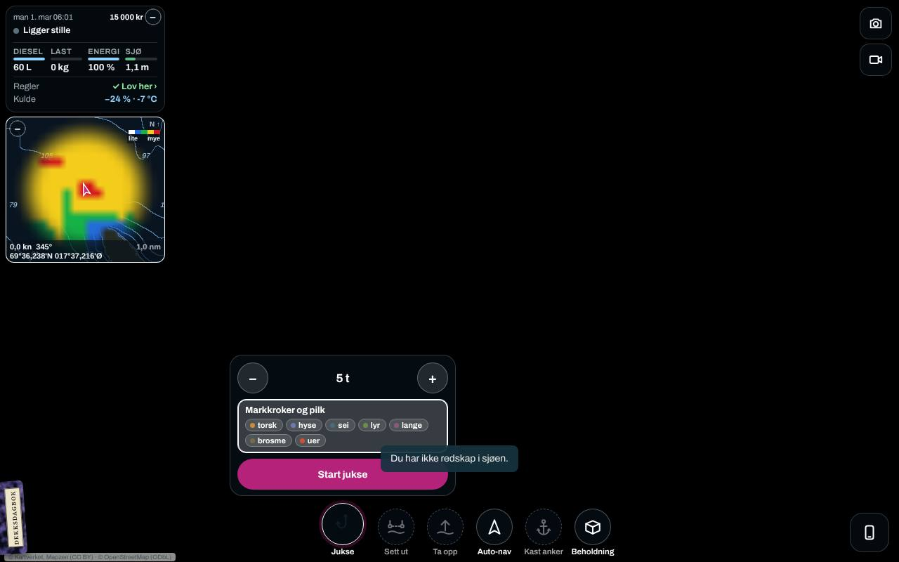 | U4: en gammel toast ligger over «Start jukse» på juksekortet |
| 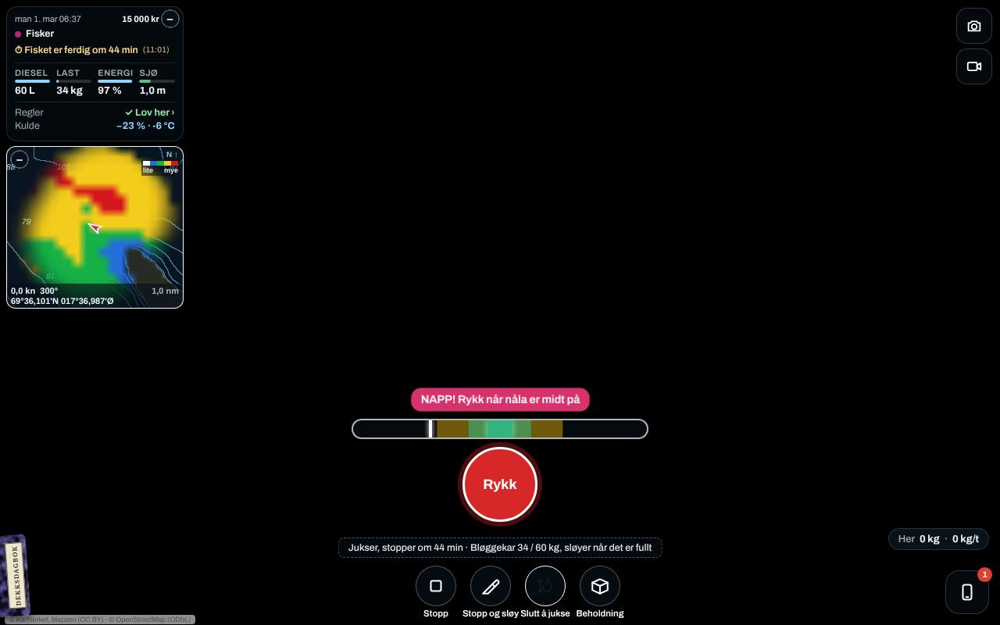 | Juksespillet: «NAPP! Rykk når nåla er midt på» |
| 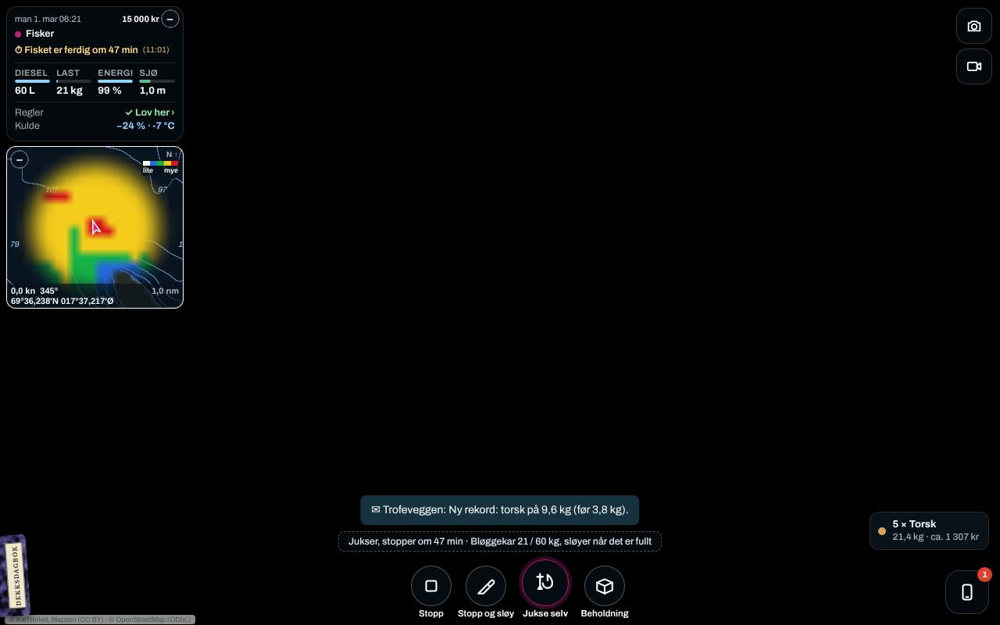 | Juksa med fangstkortene og bløggekaret. HUD-en sier «om 47 min (11:01)», kortet sa «5 t» (U1) |
| 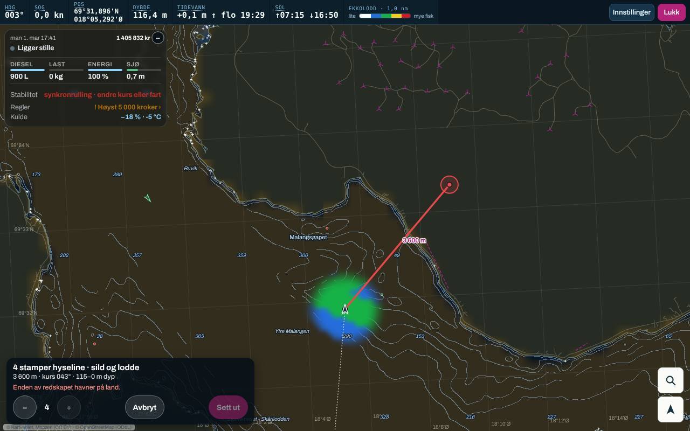 | «Sett ut»: linja rød med «Enden av redskapet havner på land.» |
| 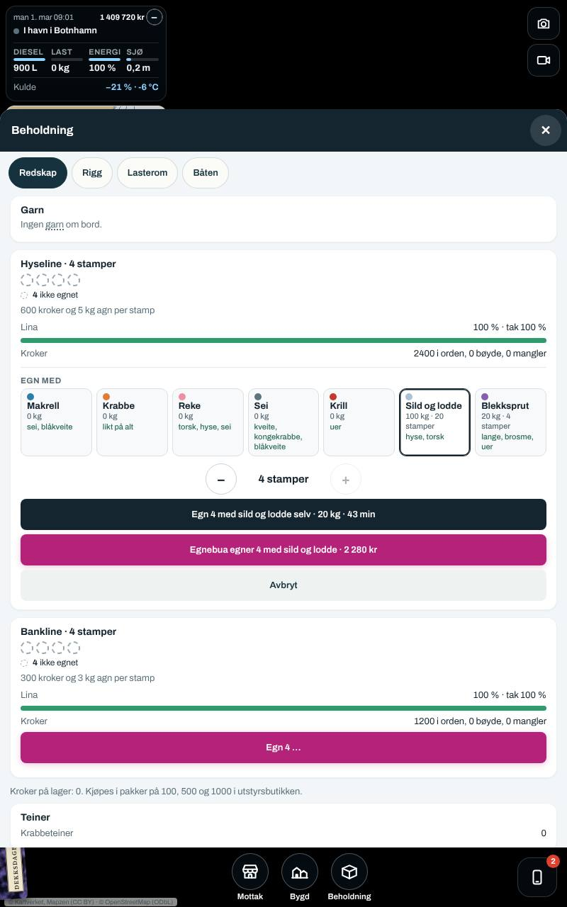 | Egnevelgeren i stående format. «Egn 4 … selv · 43 min» er ekte tid og tar 4 t 20 min på klokka (U1) |
| 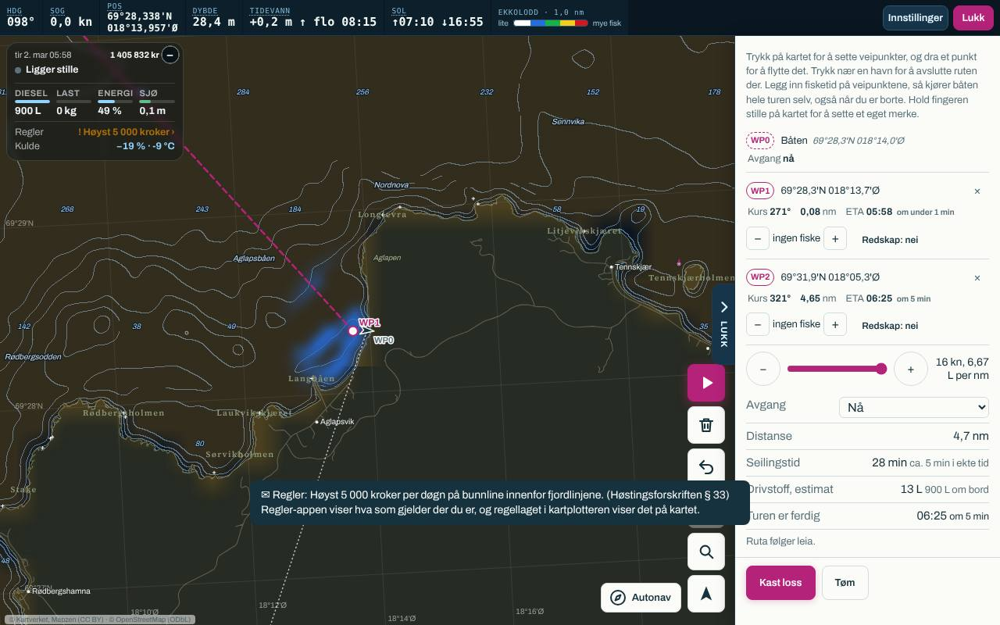 | «Kjør dit»: ruta til blåsa i plotteren, uten knappelinja (U3) |
| 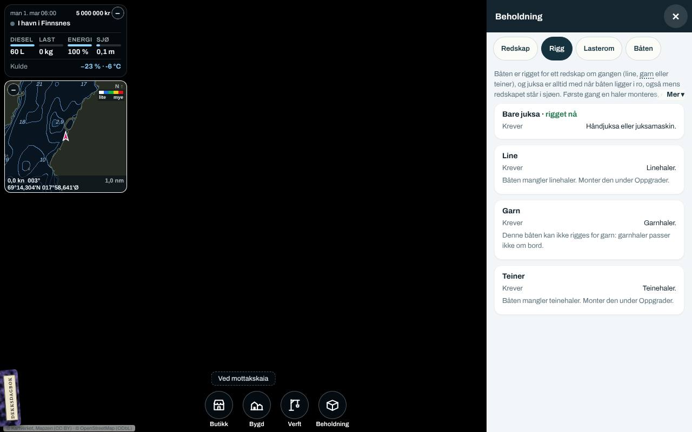 | F2: «Båten mangler linehaler. Monter den under Oppgrader.» |
| 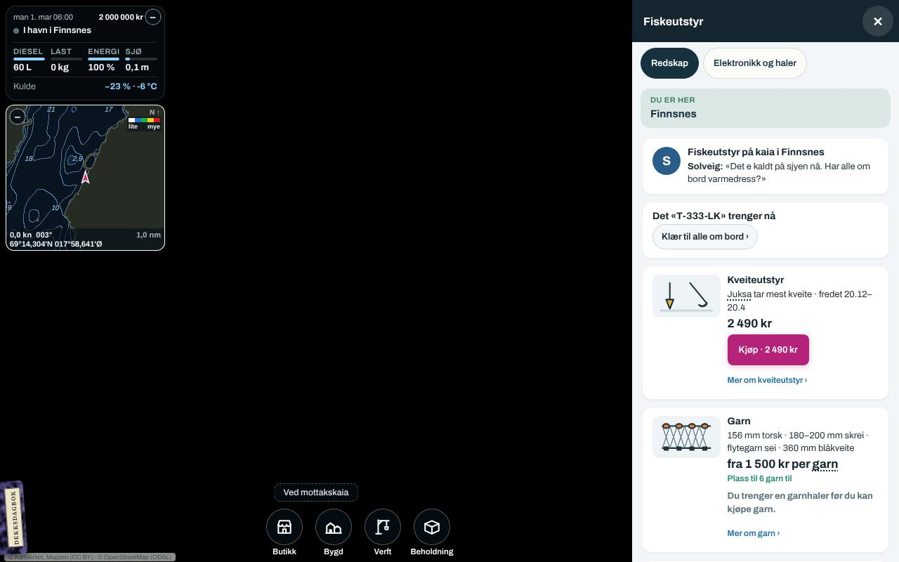 | F3: «Plass til 6 garn til» på trebåten |
| 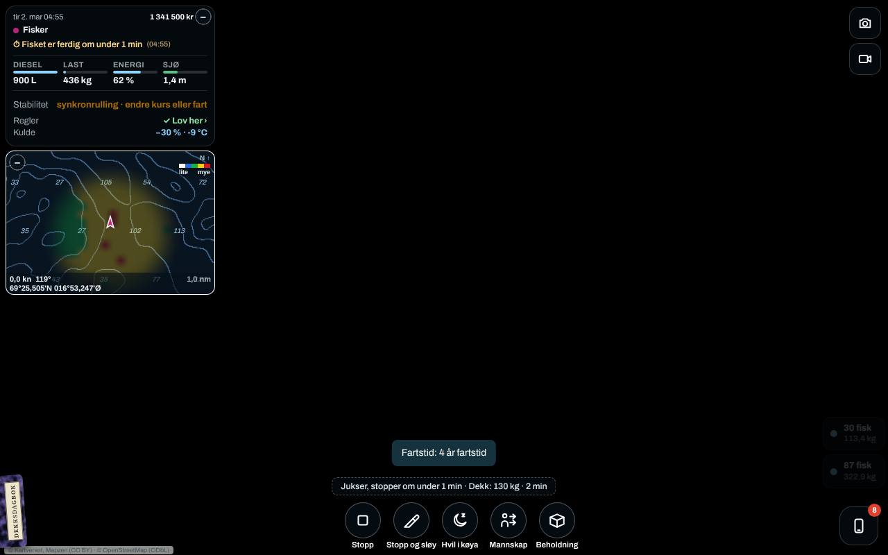 | F4: «Fisker» og «Jukser, stopper om under 1 min» rett etter garntrekket. U6: synkronrulling |
| 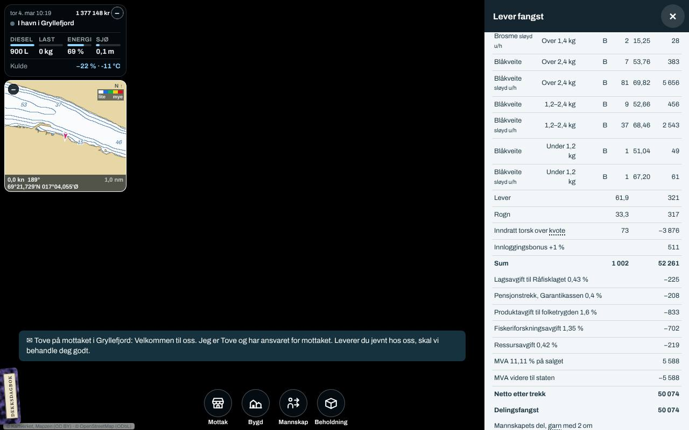 | F1: «Inndratt torsk over kvote 73 kg» under blåkveitelinjene |
| 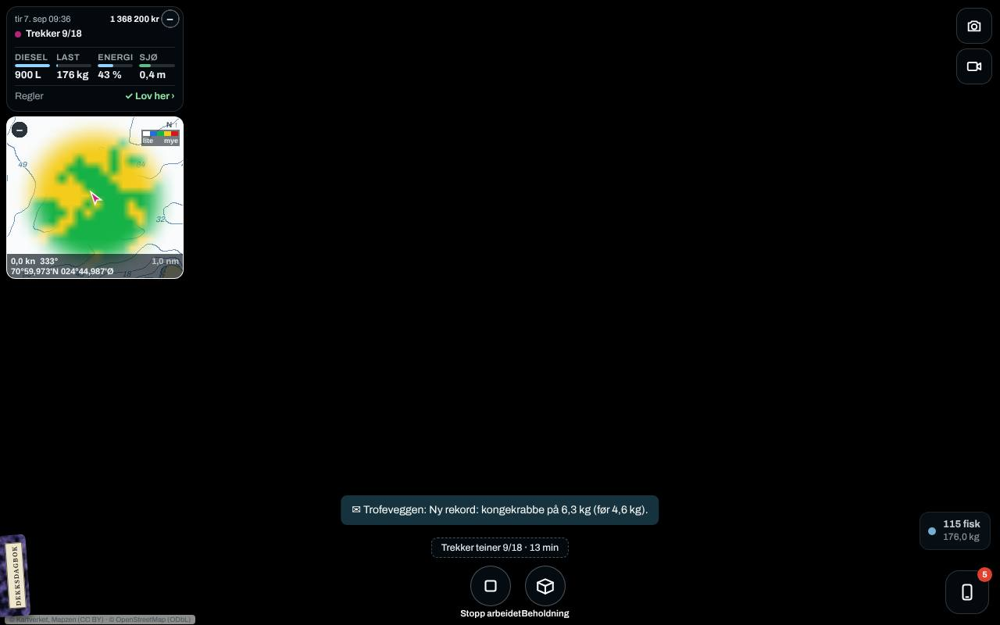 | F5: «115 fisk 180,0 kg» under teinetrekket |
| 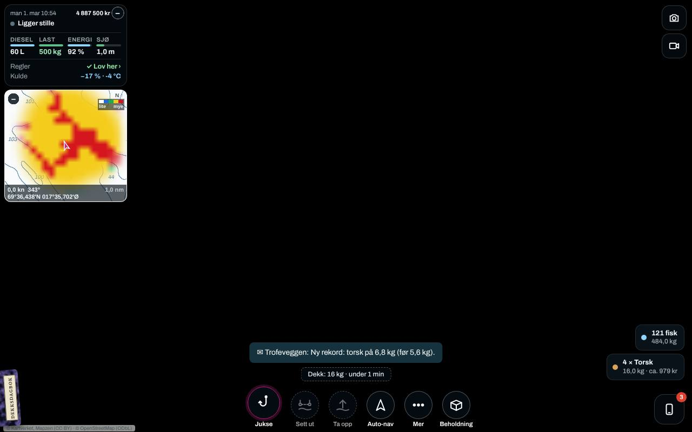 | U5: full last (500 kg) i grønt, «Jukse» er fortsatt hovedknappen |
| 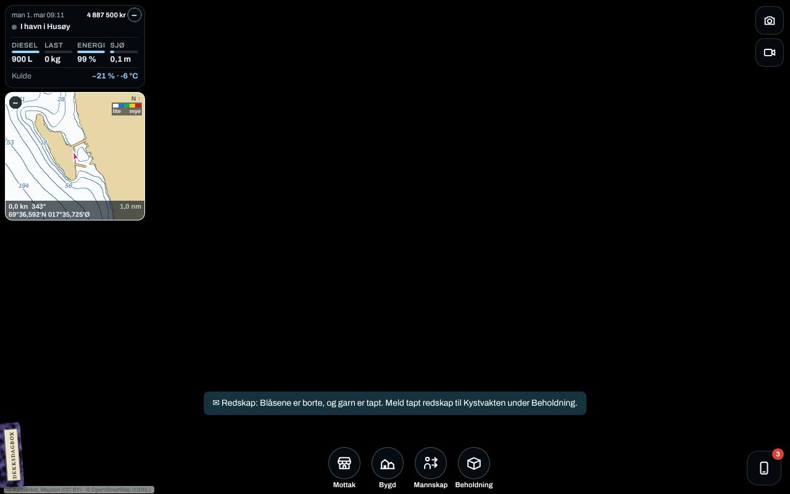 | Garn tapt i kuling, med beskjeden om å melde det |
| 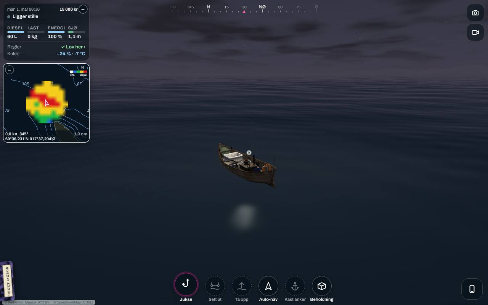 | Trebåten på feltet i 3D |

## Hvordan kjøre agenten

```
node build.mjs                      # med hele kysten: python3 tools/map/release.py && python3 tools/map/game.py først
python3 tests/fiskeplay.py          # alle scenarioene, liggende, uten 3D (rundt 10 min)
python3 tests/fiskeplay.py line garn
KYST_FP_FMT=staaende python3 tests/fiskeplay.py jig line
KYST_FP_3D=1 python3 tests/fiskeplay.py jig3d   # alene, rundt 30 s per bilde
```

Hvert scenario skriver `tests/out/fiskeplay/<format>/<scenario>/steps.json`. Fila har alle skjermbilder med det som ble sett: knappelinja, viften, statuslinja, toastene, dagboka, meldingene, lasten, redskapet i sjøen og skuffens tekst. I tillegg har den agentens notater: kjøp, tidsbruk, fangst, salg, trykk som traff noe annet, og sidefeil. Skriptet står ikke i `run.py`, fordi det er et gjennomgangsverktøy som `uiplay.py` og ikke en test med OK og FEIL. Det trenger hele kysten for Finnmark og Lofoten.
