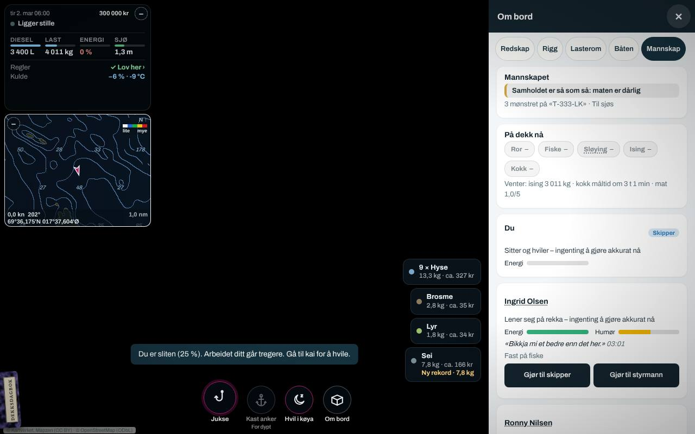
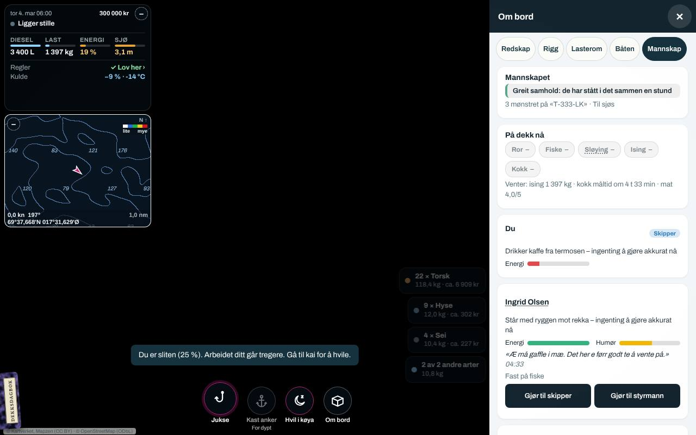
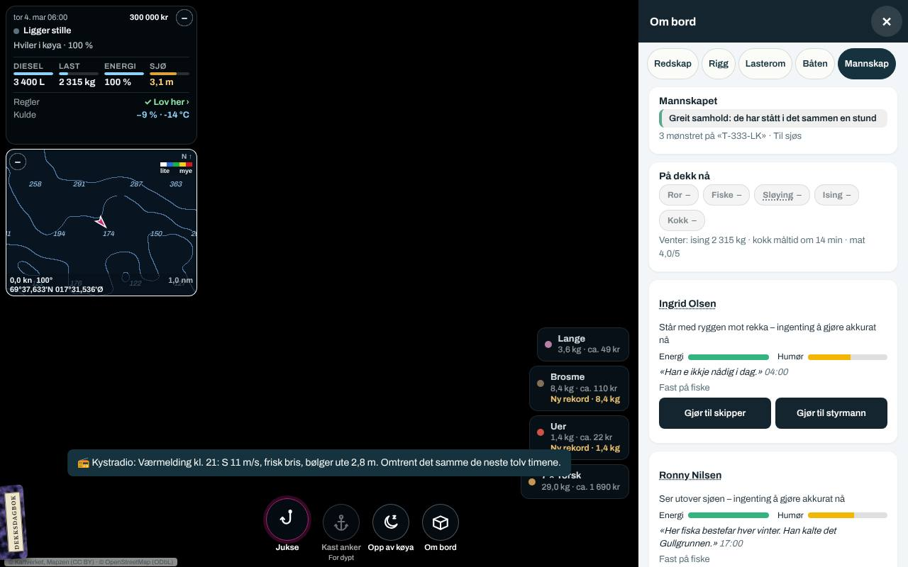

# Spilltest 4: mannskapet tre døgn på sjøen (06.11.2026, Ø8)

Bestillingen (Jonas 06.11.2026, Ø8): «Mannskapet spilltestes: en Playwright-spiller etter mønster av `fiskeplay.py` (ny `tests/mannskapsplay.py`, uten 3D) som seiler tre døgn med mannskap uten kokk, med kokk ≥ 3, og på en båt uten bysse, og skriver energien, trivselen, maten og krangelen per time til `tests/out/` og en rapport … med hva som virker og hva som er for hardt. Bare tester og dokument; det som bør endres, går i backloggen med fil og linje.» Backloggen 10.2: «Mannskapet er ikke spilltestet: du våkner med 60 % (`ENERGY.wake`); uten noen med kokk ≥ 3 blir det tørre brødskiver hvert 6. time, som gir −6 i trivselen; båter uten bysse får matpakke (−3). Følg med på om det blir for hardt.»

Spilleren er `tests/mannskapsplay.py`. Den spilte grenen `ccr-ccfb0017-rmieib` (arbeidsgrenen etter H3a, b63df02b), bygd med hele kysten (`kart-31`), uten 3D, i liggende format. Tallene per time ligger i `tests/out/mannskapsplay/<scenario>/timer.csv` og `steps.json` når skriptet er kjørt; tre bilder av Mannskap-siden ligger i `docs/playtest/r4/`.

## Sammendrag

1. **Mannskapssystemet holder tre døgn uten at noen mønstrer av eller krangler**, i alle fire scenarioene. Ingen sidefeil. Trivselen går fra 62 til 49–58, langt over grensen for å si opp (22, 15 for grinebiteren).
2. **Maten virker, men mest på innsatsen, lite på trivselen.** Uten noen som kan lage mat (kokk under 3) blir det tørre brødskiver hver 7. time (kvalitet 1), med en kokk på 4 kokt torsk med poteter (4), på snekka matpakke og kaffe fra termosen (2). Over tre døgn skiller det bare 5–6 trivselspoeng mellom brødskiver og kokt torsk (49–53 mot 54–58), men timene der mannskapet «Har lite å gi» halveres (28–29 av 48 fisketimer uten kokk, 12–15 med). Mannskap-siden sier hvorfor: «Samholdet er så som så: maten er dårlig», «kokk måltid om 3 t 1 min · mat 1,0/5».
3. **Det som er for hardt, er skipperen, ikke mannskapet.** Energien din faller 100 % på 24 timer på sjøen også når båten ligger stille om natta (`core/15-energy.js` linje 115). Uten å gjøre noe sovner du av utmattelse kl. 06–07 hver tredje morgen, akkurat når dagens fiske begynner, og sover åtte timer midt på dagen (tre ganger på tre døgn, 20 timer sovende). Våkner med 56–60 %. **Med «Hvil i køya» kl. 22 på en båt med køyer (breisjarken har fire) er energien 100 % hver morgen**, og turen går som den skal. Det er altså ikke modellen som er for hard, men at spillet ikke sier at køya finnes når det trengs: toasten ved 25 % sier «Gå til kai for å hvile» også på en båt med køyer til sjøs, mens «Hvil i køya» står i knappelinja ved siden av (bilde `r4-sliten-koye.jpg`).
4. **Slitenheten etter en 16-timers dag er høy** (81–91 av 100 kl. 22, utholdenhet 3,5–4), og innsatsen faller til 0,46–0,59 de siste timene. Natta henter alt tilbake (8 per time, 12 om natta: 0 kl. 06). Det er mannskapets svar på en lang dag, og det er rimelig.
5. **To ting å rette** (backloggen 10.2 og 10.7, med fil og linje): toasten ved 25 % energi på en båt med køyer (`ui/05b-work.js` linje 149), og «Ingen hadde tid til å lage mat» når grunnen er at ingen om bord *kan* (`core/14-crewlife.js` linje 65, `core/13-work.js` linje 240 krever kokk ≥ 3). Måltidene kommer dessuten hver 6. time fra første måltid, uansett klokka (01:28 og 05:09 om natta mens alle hviler), og kokken står opp og lager mat til folk som sover.

## Slik ble det testet

- **Oppsettet er skript, resten er spillet:** båten, datoen (1. mars 2027, kl. 06), stedet (feltet med mest torsk innen 8 km fra Husøy, 77 m), klær til alle (oljehyre og varmedress), og mannskapet fra `genCrew()` med fast frø (7) inne i blokken (de samme tre personene i alle scenarioer, bare kokkeferdigheten er satt). Timene går med `step()`, spillets eget minutt, med manøvreringsmodellen av og spillets egen løkke holdt (`TAB.held`), som `catchUp` gjør. Seilingen ut er hoppet over.
- **Rytmen:** juksa fra 06 til 22, og båten ligger stille på sjøen fra 22 til 06 (status `idle`). Lasterommet tømmes av skriptet ved 80 % så fisket går videre (8 tonn på tre døgn på breisjarken): dette er en test av mannskapet, ikke av fangsten. Ingenting besvares for spilleren: en krangel ville blitt liggende, og skipperen trykker ingenting, unntatt i `medkoye`, der «Hvil i køya» og «Opp av køya» trykkes kl. 22 og 06 (`restStart()`/`restEnd()`, det knappen gjør).
- **Per time** skrives: energien din og om du sover, sjøen, vinden og kulda, matstellet (snittet av de fire siste måltidene) og siste måltid, samholdet, krangelen, lasten, og per person slitenhet, trivsel og innsatsen med ordene fra `crewEffort` («Jevn innsats», «Går litt tregt», «Har lite å gi»), pluss loggen og meldingene den timen.
- **Scenarioene** (alle 72 timer, rundt 40 s hver uten 3D):

  | Scenario | Båt | Mannskap | Mat |
  |---|---|---|---|
  | `utenkokk` | breisjark 10,99 m, bysse, WC, fire køyer, hus | Ingrid (29, grinebiter, kokk 2), Ronny (50, lokalkjent, kokk 1), Tommy (29, lærevillig, kokk 2) | ingen kan lage mat |
  | `medkokk` | samme | samme, Ingrid kokk 4 | kokt torsk med poteter |
  | `medkoye` | samme | samme | samme, og skipperen i køya 22–06 |
  | `utenbysse` | snekke 7,9 m, hardtop, ingen bysse, ingen WC, ingen køyer | Ingrid (kokk 4) og Ronny | matpakke og kaffe fra termosen |

- **Været** med frø 1: 0,7–3,1 m sjø, 4–13 m/s, kulde 3–9 % med klær. Breisjarken tåler 2,6 m trygt, så dag 3 lå båten over grensen en stund uten at det ble målt egen effekt.
- **Svakheter:** ett frø og ett mannskap (ingen av de tre går hverandre på nervene, `compat` under −1 for ingen av parene, så krangelen er ikke prøvd); ingen levering på tre døgn (lotten mot forventningen slår inn først etter tre døgn og er ikke med); kulda er dempet med klær; seilingen og dekksarbeidet er bare det spillet gjør av seg selv; agenten kjenner ikke om noe er morsomt.

## Hva som skjedde

| | `utenkokk` | `medkokk` | `medkoye` | `utenbysse` |
|---|---|---|---|---|
| Måltider på 72 t | 10 × tørre brødskiver (1) | 10 × kokt torsk med poteter (4) | 10 × kokt torsk (4) | 11 × matpakke (2) |
| Matstell ved slutt | 1,0 | 4,0 | 4,0 | 2,0 |
| Trivsel t24 / t48 / t72 (Ingrid, Ronny, Tommy) | 53–56 / 50–54 / 49–53 | 55–58 / 54–58 / 54–58 | 55–58 / 54–58 / 54–58 | 53–55 / 50–53 / 49–52 |
| Lavest trivsel | 47 | 54 | 54 | 47 |
| «Har lite å gi», timer av 48 med fiske | 28–29 | 12–15 | 8–13 | 13–15 |
| Innsats under fiske, laveste / snitt | 0,46 / 0,80–0,83 | 0,49 / 0,86–0,88 | 0,49 / 0,86–0,90 | 0,50 / 0,83–0,85 |
| Slitenhet kl. 22 (dag 1 / 2 / 3) | 81–91 / 70–78 / 70–78 | samme | samme | 83–87 / 70–75 / 70–75 |
| Samhold 50 → | 44 | 56 | 56 | 48 |
| Krangler | 0 | 0 | 0 | 0 |
| Mønstret av | 0 | 0 | 0 | 0 |
| Skipperens energi t24 / t48 / t72 | 0 / 0 / 0 | 12 / 13 / 19 | 100 / 100 / 100 | 0 / 0 / 0 |
| Sovnet av utmattelse | 3 ganger (kl. 06–07), 20 t sovende | 2 ganger (t27 og t53), 16 t | aldri (lavest 41 %) | 3 ganger (kl. 06–07), 20 t |
| Våknet med | 56–58 % | 57–60 % | – | 56–58 % |
| Feil på dekk (glipp, stygg sløying, kutt) | 1 | 4 | 0 | 3 |

- **Uten kokk:** når måltidet er forfalt, får ingen stå ved Kokk, fordi `workAssign` bare setter folk med kokk ≥ 3 der (`core/13-work.js` linje 240). Etter en time kommer «Ingen hadde tid til å lage mat. Det ble tørre brødskiver.» (`core/14-crewlife.js` linje 65), også kl. 03 mens alle hviler og har tid. Mannskapet sier «Bikkja mi et bedre enn det her» og «Neste tur tar æ med niste fra mor». Trivselens mål får −6 (`core/04-crew.js` linje 452) og kranglesjansen ×1,6 (linje 466), men med glidningen 0,04 per time (linje 457) blir det 5–6 poeng på tre døgn. Innsatsen merker det mer: «Har lite å gi» i 28–29 av 48 fisketimer, mot 12–15 med kokt torsk (`crewDrive` i `04-crew.js` linje 303: sult og maten).
- **Med kokk:** Ingrid lager mat kl. 12:30, 18:59, 01:28, 09:37, 18:55, 01:24 … Det gir deg +4 % energi per måltid og mannskapet «Nu snakke vi! Det her e mat førr folk som jobbe.» Men måltidene følger ikke klokka: det er `MEAL.every` (360 min) fra forrige måltid, så to av døgnets måltider kommer om natta mens båten ligger stille og alle hviler, og kokken reiser seg og lager mat til dem.
- **Uten bysse:** matpakke (2) uten at noen gjør noe (`14-crewlife.js` linje 53). −3 på trivselen, og snekka har heller ikke WC (−3 etter 12 timer). Trivselen ender 49–52, som uten kokk.
- **Skipperen:** energien faller 100/24 per time på sjøen uansett status (`15-energy.js` linje 115). Mannskapet sier fra («Skipper, du ser sliten ut. Bør du ikkje hvile litt?», «Du e grå i fjeset, skipper. Gå og legg deg, vi klare oss.»), toasten ved 25 % sier «Gå til kai for å hvile», og kl. 06 sovner du: «Du sovnet av utmattelse. Ronny tar roret.» Fisket går videre med mannskapet (dekksarbeidet, replikkene og fangsten fortsetter), og du våkner etter åtte timer med 56–60 % (`ENERGY.wake` 60, minus timens eget trekk). Med «Hvil i køya» kl. 22 (bare når noen av mannskapet er våkne og har vakta, `bunkOk`) stiger energien 8,75 % i timen (`ENERGY.quay` × 0,7 under veis) og er 100 % før kl. 05, og «Du kom opp fra køya. Energi 100 %» kl. 06. På snekka uten køyer sier toasten «Nærmeste rorbu er i Husa, 5 nm unna», som bestemt (Jonas 05.10.2026: ikke hvile i en åpen båt).
- **Slitenheten** går +6 per time under fiske (`04-crew.js` linje 438), skalert med utholdenhet og 1,25 om natta, til 81–91 kl. 22, og ned 8 per time (12 om natta) når båten ligger stille: 0 kl. 06. Over 50 trekker den trivselens mål ned 0,5 per poeng (linje 453), så målet ligger rundt 35 sent på kvelden og rundt 60 om morgenen; trivselen glir sakte mellom dem.
- **Isen** tok slutt etter ni timer (300 kg satt av skriptet) og «Tom for is. Fangsten ises ikke.» kom hver andre time resten av testen (`05-vessels.js` linje 1103, demper to timer). Ikke en mannskapssak, men 12–15 like linjer i dagboka på tre døgn.

## Hva som virker

- Maten som system: rettene etter kokkens ferdighet, byssa mot kokeplate mot ingen bysse, snittet av de fire siste måltidene, og at Mannskap-siden sier det med ord («Samholdet er så som så: maten er dårlig», «Greit samhold: de har stått i det sammen en stund» etter tre døgn med god mat, «kokk måltid om 3 t 1 min · mat 1,0/5»).
- Replikkene om mat, trøtthet og skipperen kommer til rett tid og høyst én per halvannen time.
- Søvnen av utmattelse med mannskap: den med best sjømannskap tar roret, dekket går videre, og du våkner med 60 %.
- «Hvil i køya» på båter med køyer gjør en tredøgnstur mulig akkurat som planlagt.
- Ingen mønstrer av på tre døgn, heller ikke med brødskiver: grensen (36 timer under 22) er langt unna, og oppsigelsen kommer uansett først i havn.
- Slitenheten gjør en 16-timers dag kjennbar («Har lite å gi»), og natta henter den inn.

## Hva som er for hardt, og hva som bør endres

- **For hardt: skipperen på en tredøgnstur uten å vite om køya.** Energien faller også når båten ligger stille om natta, og toasten ved 25 % peker til kai. Spilleren som ikke kjenner «Hvil i køya», sovner kl. 06 og mister dagens fiske. **Rett** (backloggen 10.2): `ui/05b-work.js` linje 149 sier «Gå ned i køya og hvil» når `restWhere(S.boat) === 'koye'` (båt med køyer, til sjøs, mannskap våkent), og «Gå til kai» ellers; dryppet `hvile` i Håndboka (kapittel 3) kan nevne køya. Dette er ikke en endring av modellen, bare av teksten.
- **Feil grunn i loggen:** «Ingen hadde tid til å lage mat» når ingen om bord kan (kokk under 3). **Rett** (10.2): `core/14-crewlife.js` linje 58–65 skiller «Ingen om bord kan lage mat. Det ble tørre brødskiver.» (ingen med kokk ≥ 3, `MEAL.ok`) fra «Ingen hadde tid». Og: kan du lage maten selv, som 5.19 i `docs/systemer/folk-om-bord.md` sier («Lager du maten selv, blir den 3»)? `workAssign` setter aldri deg ved Kokk (`13-work.js` linje 240 krever `p.c`), og det finnes ingen knapp. Enten en knapp «Lag mat» på Mannskap-siden (kvalitet 3, 30 minutter borte fra fisket), eller stryk setningen i dokumentet.
- **Måltider om natta:** `MEAL.every` teller fra forrige måltid, så kokken lager mat kl. 01 og 05 til folk som hviler. **Forslag** (10.5, må avgjøres): måltid bare når noen er i arbeid eller våkne, eller faste tider (07, 13, 19) når båten er på sjøen. Startverdi.
- **Maten gjør lite for trivselen** (5–6 poeng på tre døgn mellom 1 og 4) og mye for innsatsen. Det er ikke for hardt, snarere mildt: −6 og glidningen 0,04 er startverdier (`04-crew.js` linje 452 og 457). Vent med å endre til lotten og leveringene er med i et lengre løp (en uke med leveringer), fordi lotten mot forventningen (±12) slår inn etter tre døgn og trolig veier tyngre.
- **Krangelen er ikke prøvd:** tre personer som går overens, gir aldri `compat` under −1. En kjøring til med en kranglefant og en stolt (frøet 7 gir ikke det) hører til neste spilltest, sammen med å svare på krangelen under Mannskap.
- **«Tom for is» hver andre time** i dagboka er støy når isen er slutt og båten blir ute (10.7): én linje når isen tar slutt, og én per døgn etterpå, holder.

## Bildene

| Bilde | Viser |
|---|---|
|  | `utenkokk` etter 24 timer: energi 0 %, «Du er sliten (25 %) … Gå til kai for å hvile.» mens «Hvil i køya» står i knappelinja; Mannskap-siden: «Samholdet er så som så: maten er dårlig», «kokk måltid om 3 t 1 min · mat 1,0/5» |
|  | `medkokk` etter 72 timer: «Greit samhold: de har stått i det sammen en stund», mat 4,0/5, energi 19 % og 3,1 m sjø |
|  | `medkoye` etter 72 timer: skipperen 100 % etter natta i køya |

## Hvordan kjøre spilleren

```
node build.mjs                                   # Senja holder (feltet er ved Husøy)
python3 tests/mannskapsplay.py                   # alle fire, 72 timer, rundt 3 minutter
python3 tests/mannskapsplay.py utenkokk medkoye
KYST_MP_HOURS=24 python3 tests/mannskapsplay.py
KYST_MP_FMT=staaende python3 tests/mannskapsplay.py medkokk
```

Hvert scenario skriver `tests/out/mannskapsplay/<scenario>/timer.csv` (én rad per time), `steps.json` (radene med loggen og meldingene, oppsettet, notatene og sidefeil) og `t00.png`, `t24.png`, `t48.png`, `t72.png` av Mannskap-siden (Om bord › Mannskap). Skriptet står ikke i `run.py`: det er et gjennomgangsverktøy som `fiskeplay.py`.
